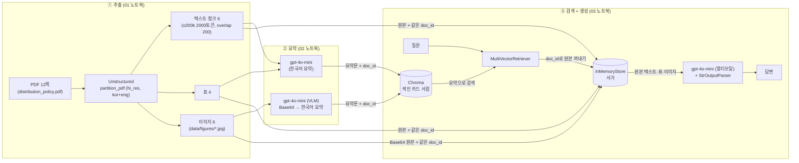
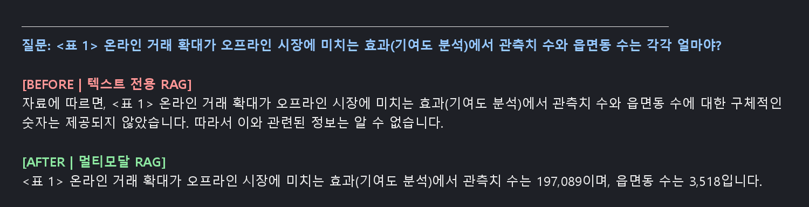
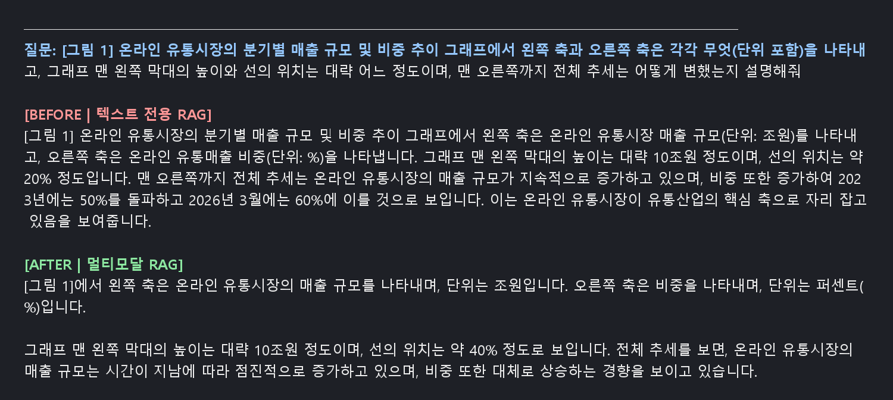

# 멀티모달 RAG — KDI FOCUS 「온라인 유통의 성장과 유통시장 정책 개선 방향」

PDF 한 편(텍스트 + 그래프 + 회귀분석 표)에서 **텍스트·표·이미지를 모두 추출·요약**하고,
**요약으로 검색 → 원본으로 답변 생성**하는 멀티모달 RAG를 구축한 과제입니다. (수업에서 쓴 LayoutParser 논문 PDF가 아닌, 본인이 고른 자료입니다.)

---

## 1. 문제 정의

| 항목 | 내용 |
| --- | --- |
| 자료 | KDI FOCUS 2026 Vol.154, 이공(KDI 연구위원), 「온라인 유통의 성장과 유통시장 정책 개선 방향」, **12쪽**, 한국어, 공개 자료 ([KDI](https://www.kdi.re.kr)) |
| 자료 구성 | 본문 텍스트 + **그래프 1개**(그림 1: 온라인 유통시장 분기별 매출 규모·비중) + **회귀분석 표 3개**(표 1~3) |
| 풀고 싶은 문제 | 이 보고서의 핵심 근거(예: *관측치 197,089, 대형마트 계수 −0.264, 로켓배송 효과*)는 **표 안의 숫자**와 **그래프 모양**에 들어 있다. 글자만 읽는 일반 RAG는 표·그림을 색인에서 빼기 때문에 이런 질문에 "알 수 없음"이라고 답한다. |
| 목표 | 표·그래프에 있는 정보까지 근거로 답하는 RAG를 만들고, **텍스트 전용 RAG와 답변을 비교**해 차이를 증거로 남긴다. |

자료의 특성과 연결한 이유: 이 보고서는 정책 제언(텍스트)을 **표 1~3의 계수·표준오차·유의수준**으로 뒷받침하는 구조라서, 표를 읽지 못하면 "근거가 무엇인가" 질문에 답할 수 없습니다. 또 한국어 문서라 OCR(한글)·요약 언어 선택이 검색 품질에 직접 영향을 줍니다.

---

## 2. 아키텍처



**3단계 요약:** ① PDF를 텍스트/표/이미지로 분리 → ② 각각 한국어 요약문으로 변환 → ③ **요약문은 벡터 DB(검색용)**, **원본은 docstore(전달용)** 에 같은 `doc_id`로 저장하고, 질문이 오면 요약으로 찾아 **원본을 멀티모달 LLM에 넘겨** 답변을 만듭니다.

### 왜 "요약으로 검색, 원본으로 생성"인가 (구조 이해)

- **검색은 요약으로**: 표(숫자 나열)·그림(픽셀)은 그대로는 질문과 의미를 비교하기 어렵습니다. 한국어 요약문으로 바꾸면 질문(한국어)과 같은 공간에서 비교할 수 있고, 글자가 하나도 안 겹치는 그림도 요약을 거쳐 찾아집니다.
- **생성은 원본으로**: 요약은 줄인 내용이라 `197,089`, `−0.264` 같은 **정확한 수치와 그림의 모양**이 빠집니다. 답변은 원본 표·텍스트·이미지(Base64)를 직접 보고 만들어야 정확합니다.
- **같은 `doc_id`**: 요약과 원본을 잇는 청구기호입니다. 이게 없으면 요약이 검색돼도 짝인 원본을 꺼낼 수 없습니다.

---

## 3. 폴더 구조

```
multimodal-work/
├── README.md
├── requirements.txt          # 직접 설치하는 패키지
├── requirements.lock.txt     # 실행 검증에 쓴 전체 버전 고정본
├── .env.example              # 키 형식 예시 (실제 키는 .env 에 — 저장소에 올리지 않음)
├── .gitignore
├── notebooks/
│   ├── 01_데이터추출.ipynb      # PDF → 텍스트/표/이미지, data/figures 생성
│   ├── 02_요약생성.ipynb        # 텍스트·표·이미지 요약 (LLM/VLM)
│   └── 03_검색기_최종체인.ipynb  # 다중 벡터 검색기, 체인, Before/After, 질의응답 5건
├── docs/
│   ├── before_after_graph.png  # Before/After 캡처 ① (그래프 질문)
│   └── before_after_table.png  # Before/After 캡처 ② (표 질문)
└── data/                      # (아래 항목은 .gitignore 대상 → 저장소에 없음)
    ├── distribution_policy.pdf
    ├── figures/               # 추출된 이미지
    └── processed/             # extracted.pkl, summaries.pkl
```

모든 노트북은 **실행 결과 셀이 남아 있습니다.**

---

## 4. 실행법

### 4-0. 사전 준비 (윈도우)

- Python 3.11, VS Code
- **Poppler**, **Tesseract(한글 `kor` 데이터 포함)** 설치 후 PATH 등록 (`pdftoppm`, `tesseract --list-langs` 로 확인)
- OpenAI API 키
- 프로젝트 경로에 **한글·공백이 없어야** 합니다.

### 4-1. 가상환경 만들고 켜기 (VS Code 터미널, PowerShell)

```powershell
python -m venv .venv
.\.venv\Scripts\Activate.ps1
pip install -r requirements.lock.txt
python -m ipykernel install --user --name multimodal-work --display-name "Python (multimodal-work .venv)"
```

### 4-2. 키 설정

```powershell
copy .env.example .env      # 열어서 OPENAI_API_KEY 에 본인 키 입력 (.env 는 .gitignore 에 포함됨)
```

### 4-3. PDF 준비

KDI 홈페이지(www.kdi.re.kr)에서 **KDI FOCUS 2026 Vol.154** 를 내려받아 `data/distribution_policy.pdf` 로 저장합니다. (`*.pdf` 는 `.gitignore` 대상이라 저장소에는 올리지 않았습니다.)

### 4-4. 노트북 실행

VS Code에서 커널을 `Python (multimodal-work .venv)` 로 선택하고 **01 → 02 → 03** 순서로 실행합니다. (01은 hi_res 추출로 1~2분, 02·03은 API 비용 발생 — 02의 요약 셀은 한 번만 실행)

---

## 5. 기술 선택 근거

| 항목 | 선택 | 근거 |
| --- | --- | --- |
| 추출 | `partition_pdf(strategy="hi_res", languages=["kor","eng"])` | 표 구조·이미지를 잡으려면 레이아웃 모델(hi_res)이 필요. **한글 PDF라 `kor` OCR을 추가**(수업 PDF는 영어였음) |
| 청크 | `CharacterTextSplitter.from_tiktoken_encoder(encoding_name="o200k_base", chunk_size=2000, chunk_overlap=200)` | 겹침 200으로 경계에서 문맥이 끊기는 것을 방지. 기본 토크나이저(gpt2)는 한글을 약 3배로 세어 시험 실행에서 **21개의 잘디잔 조각**이 나왔기에, 쓰는 모델(`gpt-4o-mini`)과 같은 `o200k_base`로 맞춰 6개로 정상화 |
| 요약/답변 모델 | `gpt-4o-mini` (`temperature=0`) | 요약은 창작이 아닌 압축이라 작은 모델로 충분, 이미지(VLM)까지 한 모델로 처리, 가장 저렴. 답변을 안정적으로 재현하려고 `temperature=0` |
| 프롬프트 언어 | 텍스트·표 요약: **한국어** / 이미지 요약: **영어 지시 + 한국어 결과** | 질문이 한국어이고 요약문을 임베딩해 질문과 비교하므로 요약 결과는 한국어여야 함. 이미지 지시문은 영어가 지시 이행이 안정적. 그래프·표 이미지라 "축 이름·수치 범위·추세·표 제목과 수치를 포함" 줄을 추가 |
| 임베딩 | `text-embedding-3-small` | 짧은 한국어 요약문끼리의 비교라 소형 모델로 충분하고 저렴 |
| 벡터DB/저장소 | Chroma + `InMemoryStore` | 학습 구성 그대로. 서비스화하려면 파일/Redis/DB와 Chroma `persist_directory` 필요 |
| 환각 방지 | 프롬프트에 "자료에 없는 내용은 모른다고 답하세요" | 근거 없는 수치 생성을 막기 위함 |

---

## 6. Before / After 비교 (텍스트 RAG vs 멀티모달 RAG)

두 체인은 **이미지·표를 색인에서 뺀 것 외에는 모델·프롬프트·청크·임베딩이 모두 같습니다.** (노트북 03의 8번 셀 출력을 이미지로 옮긴 캡처입니다.)

### ② 표 질문 — 차이가 뚜렷함



| | 답변 |
| --- | --- |
| BEFORE (텍스트 전용) | "구체적인 숫자는 제공되지 않았습니다 … 알 수 없습니다." |
| AFTER (멀티모달) | "관측치 수는 **197,089**이며, 읍면동 수는 **3,518**입니다." (PDF 표 1과 일치) |

**차이의 이유:** 텍스트 전용 RAG는 표를 색인에서 뺐기 때문에 표 안에만 있는 값을 찾지 못합니다. 멀티모달 RAG는 표 요약으로 검색한 뒤 **원본 표**를 답변에 넘깁니다.

### ① 그래프 질문 — 차이가 작았고, After도 수치는 부정확



- BEFORE는 축 이름·단위를 답했지만(그림 1의 축 글자가 PDF 텍스트 층에도 있음), 맨 왼쪽 막대·선의 위치는 **근거 없이 지어낸 값**(선 약 20%)을 말했습니다.
- AFTER는 그림을 보고 우상향 추세를 답했지만 시작값(10조원·약 40%)은 실제(약 8~9조원·약 31%)와 어긋났습니다.
- 즉 **표 질문에서는 확실한 개선**, **그래프 질문에서는 "그림을 근거로 답한다"는 구조상의 차이는 있으나 눈금 수치 판독은 부정확**했습니다. (한계 참고)

---

## 7. 질의응답 5건

노트북 03의 9번 셀이 출력한 결과이며, 정답 여부는 PDF 원문과 직접 대조했습니다. "근거가 된 원본 종류"는 검색기가 반환한 원본의 종류(이미지/표/텍스트 개수)입니다.

| # | 질문 | 답변 | 근거가 된 원본 종류 | 원문 대조 |
| --- | --- | --- | --- | --- |
| 1 | [그림 1] 그래프에서 왼쪽·오른쪽 축은 각각 무엇(단위 포함)이고, 맨 왼쪽 막대 높이와 선의 위치는 대략 어느 정도이며, 맨 오른쪽까지 추세는? | 왼쪽 축은 온라인 유통시장 매출 규모(조원), 오른쪽 축은 비중(%). 맨 왼쪽 막대는 대략 10조원, 선은 약 40%. 전체적으로 상승세(중간 부분에서 급격한 상승). | 이미지 1 + 표 2 + 텍스트 1 | △ 축·추세는 맞음, 시작값은 부정확(실제 약 8~9조원 / 약 31%) |
| 2 | <표 2> 업태별 분석에서 '(1) 대형마트' 열의 1인당 온라인 지출 계수·표준오차·시군구 수는? | 계수 −0.264, 표준오차 0.113, 시군구 수 173. | 표 3 + 텍스트 1 | ○ |
| 3 | <표 1>에서 종속변수가 '업체 수'인 모형의 1인당 온라인 지출 계수·유의수준, 관측치 수·읍면동 수는? | 계수 0.152***(유의수준 ***), 관측치 수 197,089, 읍면동 수 3,518. | 표 4 | ○ |
| 4 | <표 3>에서 '로켓배송 도입' 행의 (1) 매출 열 계수·표준오차·별(*) 개수는? | 계수 0.053, 표준오차 0.030, 별 1개. | 표 3 + 텍스트 1 | ○ |
| 5 | 이 보고서가 제시한 유통정책의 시사점 네 가지는? | ① 온·오프라인 간 규제 형평성 확보 ② 근거리 기반 소규모 오프라인 업체의 성장 기반 조성 지원 ③ 온라인 물류 체계 발전을 고려한 유통정책 조정 ④ 온라인 유통 플랫폼의 공정경쟁 환경 조성 (각 항목 설명 포함) | 표 1 + 텍스트 3 | ○ |

> 위 표의 답변은 노트북 출력 원문을 줄여 옮겼습니다(1·5번은 일부 문장 생략). 전체 문장은 03 노트북 9번 셀 출력에 있습니다.

---

## 8. 한계

1. **그림 추출 시 아래쪽이 잘림**: 추출된 그림 1에는 x축 연도(2016~2024)와 `주/자료` 주석이 빠져 있어 "2016년 값" 같은 연도별 질문은 그림만으로 답할 수 없습니다. (그래서 질문 1은 이미지에 실제 보이는 정보로 설계)
2. **VLM의 눈금 판독이 부정확**: 그래프의 대략적인 수치(시작값)를 `gpt-4o-mini`가 틀리게 읽었습니다. 정확한 수치가 필요하면 원 데이터를 쓰거나 더 큰 비전 모델이 필요합니다.
3. **표가 한 줄 문자열로 펴져 행·열 대응 오류가 남**: 처음 시도한 질문에서 실제로 틀린 답이 나왔습니다.
   - 2번: "계수가 음수인 업태는?" → 표 1의 열 값(−0.020, 3,518)을 섞어 SSM까지 음수라고 답함 (실제 SSM은 +0.221).
   - 4번: "교차항의 (3) 결제 건수 계수(−0.010**)" → 같은 열의 다른 행 값(0.009)을 답함.
   → 열·행 이름을 명시한 질문으로 바꿔 5건을 구성했습니다. 표를 HTML(`text_as_html`)로 보존하면 개선될 수 있으나 이번 학습 범위(문자열 저장)에서는 적용하지 않았습니다.
4. **불필요한 이미지도 색인됨**: 표지의 KDI 로고·QR·일러스트 등 5장도 이미지로 추출·요약되어 검색 후보에 섞입니다. 관련 없는 표·텍스트가 함께 검색되는 것도 검색 k=4 고정 때문입니다.
5. **표 요약 오류 가능성**: 표 1 요약에서 열 이름 일부가 뒤섞인 부분이 있었습니다(요약은 검색용이고 답변은 원본을 쓰므로 영향은 제한적).
6. **실행마다 답이 조금 달라질 수 있음**: `temperature=0` 이어도 검색 결과 구성과 모델 출력이 완전히 같다고 보장되지는 않습니다.
7. **저장소 휘발성**: `InMemoryStore`는 커널 종료 시 사라집니다. 서비스화하려면 영속 저장소로 교체해야 합니다.
8. **평가 규모**: 질의 5건에 대한 수동 대조만 했고, 자동 평가 지표(정확도·재현율)는 구하지 않았습니다.
9. **번역 체인(Ollama) 미구현**: 수업의 선택 과제(9번)는 시간·용량 문제로 구현하지 않았습니다.

---

## 9. 보안

- API 키는 `.env` 에만 있고 `.gitignore` 로 제외했습니다. 저장소에는 형식 예시인 `.env.example` 만 있습니다.
- 노트북 출력에는 키를 **일부도 출력하지 않습니다**(로드 여부만 표시).
- `.gitignore`: `.venv/`, `.env`, `data/figures/`, `*.pdf`, `chroma_db/`, `processed/`, `*.pkl`, `__pycache__/`, `.ipynb_checkpoints/`, `.vscode/`, `.idea/`
- `data/processed/*.pkl` 은 이 프로젝트가 직접 만든 파일만 `pickle.load` 합니다. (출처를 모르는 pickle은 열면 안 됩니다.)
